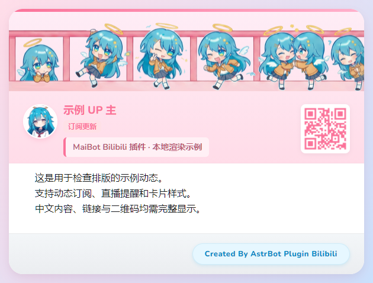

# Bilibili for MaiBot

从 [Soulter/astrbot_plugin_bilibili](https://github.com/Soulter/astrbot_plugin_bilibili) 移植的独立 MaiBot 插件。保留上游 B站客户端、动态过滤、凭据维护、番剧查询逻辑和三套 HTML 卡片模板，重新实现宿主接口、推送状态、命令、管理页及消息解析。

本版插件 ID：`github.sora-maru.bilibili`，版本：`1.0.3`。

1.0.3 根据维护者向上游作者取得的许可证确认，补齐 GNU AGPL v3 许可证全文，清单及项目元数据统一声明为 `AGPL-3.0-only`；本次不修改插件功能。

1.0.2 更换插件 ID，并补齐卡片样式、文字模板及摘要模型的中文填写说明。文字模板和摘要提示词改为多行输入。改 ID 后的数据保留步骤见本文「数据与迁移」。

1.0.1 将配置页的全部分组和字段显示名改为中文，并补齐中文说明。配置键、默认值及配置格式版本保持兼容，升级时保留原有配置即可。

移植版仓库：[sora-maru/maibot_plugin_bilibili](https://github.com/sora-maru/maibot_plugin_bilibili)。插件清单中的仓库、文档和问题反馈地址均指向本移植版，上游来源与署名见 [THIRD_PARTY_NOTICES.md](THIRD_PARTY_NOTICES.md)。

## 配置问题快速查阅

- [默认卡片长什么样、还有哪些样式可选？](#卡片样式)
- [文字推送模板和转发原文模板留空是什么意思、如何填写？](#文字模板如何填写)
- [摘要模型填什么，能否沿用 MaiBot 的模型？](#摘要模型如何填写)
- [摘要提示词如何填写？](#摘要提示词如何填写)

初次使用建议保留 `template_2`，两个文字模板和摘要提示词都留空。需要智能摘要时开启「启用动态智能摘要」，摘要模型留空使用 `utils` 辅助任务；希望沿用日常聊天的回复任务配置则填写 `replyer`。

## 目标环境

- MaiBot **1.3.16**。
- `maibot-team.snowluma-adapter` **1.1.9**。
- SnowLuma **2.4.0**（用户提供的 2.4 系列版本）。
- MaiBot Plugin SDK **2.16.0 或更高的 2.x**。本地按 2.16.0 测试。
- Python ≥3.11；本地验证使用 Python 3.13。其他宿主、SDK 和平台组合尚未联调。

只需要连接器现有的 QQ 连接，不需要在本插件再次填写 SnowLuma 端口或 Token。

## 安装与首次使用

可以在 MaiBot 插件管理中使用本仓库地址安装：`https://github.com/sora-maru/maibot_plugin_bilibili`。手动安装时，也可以从 GitHub 下载源码 ZIP，解压后将包含 `plugin.py` 的目录命名为 `maibot_plugin_bilibili` 并放入 `plugins/`，不要把外层解压目录一起套进去。

1. 将安装包解压，把整个 `maibot_plugin_bilibili` 文件夹放进 MaiBot 实例的 `plugins/`。确保入口为 `plugins/maibot_plugin_bilibili/plugin.py`，不要多套一层目录。
2. 在 MaiBot 中重载插件或重启，确认插件正常加载。依赖列在 `_manifest.json` 和 `requirements.txt`；如宿主提示缺包，使用 **运行 MaiBot 的同一个 Python 环境**执行 `python -m pip install -r plugins/maibot_plugin_bilibili/requirements.txt`。使用 uv 管理实例时可执行对应的 `uv pip install -r ...`。
3. 打开本插件配置，将 `access.admin_users` 设置为管理员 QQ 号列表。QQ 号作为字符串填写，例如 TOML 的 `admin_users = ["123456789"]`。SDK 会生成实际配置；`config.example.toml` 仅供参考。
4. 管理员**私聊**机器人发送 `/bili_login`，用 Bilibili App 扫码。也可在插件配置 `bili.sessdata` 中填写凭据。扫码凭据优先，单独保存在插件标准数据目录，管理页不会返回凭据内容。
5. 让机器人先收到目标群或好友的一条消息。在该聊天中发送 `/bili_sid` 可查看真实聊天流 ID。
6. 在群聊发送 `/bili_sub 123456`，或打开 WebUI「插件扩展 → Bilibili 订阅管理」，选择聊天并填写 B站 UID 后保存。
7. 可先用 `/bili_sub_test 123456` 检查取数和消息渲染。测试不会改变订阅游标，也不会触发 @。

首次订阅会记住已有动态，从后续更新开始推送。如果首次 B站请求失败，首次恢复查询时建立基线，不补发旧动态。直播提醒在轮询检测到状态变化时发送，不是实时 WebSocket 直播监听。

## 已移植功能

- 自动解析 BV 号、B站视频链接和 b23.tv 短链，返回封面、UP 主、统计与视频链接。
- 接入适配器保留的 B站小程序分享链接；检测同一聊天同一视频的冷却时间。
- 按聊天订阅视频、文字、图文、专栏及转发动态，支持类型过滤与正则过滤。
- 开播、下播与直播时长通知，支持关闭下播通知。
- `@全体`、仅开播 `@全体`、指定订阅者提醒；下播不 @。
- 三套原始卡片模板、样式切换、自定义头像、纯文字模板及渲染失败时的原图消息。
- 合并转发推送；真实 @ 提醒放在转发外发送。
- 过长或过大的图片以文件上传，使用 Base64 传输，不要求 MaiBot 与 SnowLuma 共享文件目录。
- 扫码登录、登录凭据保存、按 B站要求刷新及退出登录。
- 五个 LLM 工具：`bgm_search_subjects_advanced`、`bgm_recommend_hot_subjects`、`get_bgm_daily_schedule`、`bili_search_hot_videos`、`bili_get_user_dynamics`。
- 可选 AI 动态摘要，可指定模型任务或具体模型；开启原图参与摘要时需要模型支持视觉。
- 网页订阅增删改、UP主查询、提醒名单、样式、头像上传及投递待确认处理。
- 多聊天共用同一 UID 的动态和直播查询，避免按聊天重复请求。

## 常用命令

| 命令 | 说明 |
| --- | --- |
| `/bili_help` | 查看帮助 |
| `/bili_sid` | 当前聊天流 ID |
| `/bili_sub UID [过滤器/提醒选项]` | 添加或更新当前聊天的订阅；别名 `/订阅动态` |
| `/bili_sub_list` | 当前聊天订阅；别名 `/订阅列表` |
| `/bili_sub_del UID` | 删除当前聊天的订阅；别名 `/订阅删除` |
| `/bili_sub_test UID` | 测试最新可解析动态；别名 `/订阅测试` |
| `/bili_global_sub 聊天流ID UID [选项]` | 插件管理员为指定聊天订阅 |
| `/bili_global_list` | 插件管理员查看所有订阅 |
| `/bili_global_del 聊天流ID` | 插件管理员精确删除该聊天全部订阅 |
| `/bili_login` | 插件管理员私聊扫码登录B站 |
| `/bili_logout` | 插件管理员注销并清除扫码凭据，恢复配置中的 SESSDATA（如有） |
| `/bili_card_style [template_1/template_2/simple]` | 插件管理员查看或切换样式；别名 `/卡片样式` |
| `/bili_pending` | 查看当前聊天的待确认投递 |
| `/bili_pending UID ack` | 已在 QQ 收到，确认并继续监听 |
| `/bili_pending UID retry` | 确认没收到，允许下轮重试 |

全局订阅命令使用 **MaiBot 聊天流 ID**，不接受 AstrBot UMO 或直接把群号当聊天流 ID。聊天流由宿主解析和创建，插件不自行计算哈希 ID。

## 过滤与提醒

类型过滤器：`forward`、`lottery`、`video`、`article`、`draw`、`live`、`live_end`、`forward_lottery`。

其他参数按正则过滤。空格分隔多个参数，含空格的表达式用引号包裹。每条表达式最多200字符。动态标题和正文都会参与过滤；类型、权限及 B站返回内容仍决定是否可解析。

提醒选项：

- `at_all`：普通动态和开播时尝试 @全体。
- `live_atall`：仅开播时尝试 @全体。
- `at_sub`：把命令发送者加入该 UP 主的个人提醒名单。
- `unat_sub`：从该提醒名单移除命令发送者。

例如：`/bili_sub 123456 lottery forward 广告 live_atall`。

默认允许群主、群管理员管理本群订阅，普通群成员只能为**已有订阅**执行 `at_sub/unat_sub`。这些个人操作不会清空原过滤器或 @全体设置。若需要开放群成员订阅，可开启 `access.allow_member_subscribe`；设置 @全体仍要求管理员权限。私聊用户可管理自己的订阅，B站账号登录与全局管理由插件管理员控制。

网页保存会完整替换该订阅的过滤器和提醒名单。要关闭 `at_all/live_atall`，在网页移除对应选项后保存。机器人自身需要群管理员权限和可用的 @全体次数，查询无法确认时使用普通消息或个人 @。无需开启适配器的“文本转 @”开关。

## 渲染与模型

卡片使用 MaiBot **`render.html2png`** 能力，不依赖 AstrBot t2i 服务。宿主的 `plugin_runtime.render` 需要启用，浏览器环境须可用。MaiBot 可使用已有浏览器、远程 CDP 或按其配置管理 Chromium。图片渲染失败时插件仍会发送文字与原图。

`push.render_as_image = false` 可使用文字模式。模板字段为 `{name}`、`{uid}`、`{action}`、`{title}`、`{text}`、`{url}`；原动态模板为 `plain_push_template`，转发原文模板为 `plain_push_forward_template`。样式命令和网页选择会保存；配置页明确修改样式后也会生效。

AI 摘要默认关闭。开启 `ai.enable_summary` 后，可设置 `ai.model` 和 `ai.summary_prompt`；提示词使用 `{content}` 插入动态。`ai.include_images` 默认关闭，开启需要视觉模型。常规推送和摘要通过宿主接口同步到 MaiSaka 历史；直接上传超长图文件的分支没有额外构造会话内容。

### 卡片样式

| 配置值 | 中文名称 | 外观 | 预览 |
| --- | --- | --- | --- |
| `template_2` | B站粉风格（默认） | 粉色作者区、顶部横幅、白底正文、右侧二维码及柔和渐变背景 | [查看图片](docs/previews/template_2.png) |
| `template_1` | 经典风格 | 粉紫渐变背景、圆角作者栏和正文区域，右侧显示二维码 | [查看图片](docs/previews/template_1.png) |
| `simple` | 简约风格 | 浅灰背景、白色卡片，简洁头像和标题，保留二维码 | [查看图片](docs/previews/simple.png) |

默认 `template_2` 的示例效果如下，预览使用演示内容，实际推送会替换为相应 UP 主和动态：



这些是固定样式值；也可在订阅管理页用中文下拉框选择，或使用 `/bili_card_style` 命令切换。模板自带的作者署名和资源予以保留。

### 文字模板如何填写

两个字段都是**直接填写模板正文**，没有需要输入的预设名称。留空就会使用内置格式，并非不发送内容。模板只影响关闭图片卡片或渲染失败后的文字消息，不影响正常渲染的图片卡片。

文字推送模板留空时，会按「作者＋动态动作、标题、正文、链接」依次输出，移除空行。示例：

```text
📣 {name} {action}
{title}
{text}
{url}
```

只需要简短通知时，也可填：

```text
{name} 有新动态：{title}
{url}
```

正文、标题可能为空，例如纯文字动态通常没有标题；正文不需要时可省略 `{text}`。原图和转发内容仍会自动附加。

「转发原文模板」指 **B站动态中被转发的原动态**，与「使用合并转发推送」的 QQ 消息包装方式不同。示例：

```text
原作者：{name}
{title}
{text}
{url}
```

插件会在它前面追加「转发原文：」。上游没有提供的原动态链接会显示为空，不会凭空补出。

### 摘要模型如何填写

本版复用 MaiBot 已配置的模型。对于 **MaiBot 1.3.16**，插件 LLM 接口的默认任务是 **`utils`**，不一定等于平时聊天使用的模型：

| 字段内容 | 使用的模型配置 |
| --- | --- |
| 留空 | `model_task_config.utils` 辅助任务，适合总结和整理 |
| `utils` | 显式选择辅助任务，与留空相同 |
| `replyer` | `model_task_config.replyer` 回复任务，沿用其模型列表及选取策略 |
| 已配置模型的名称 | 直选该模型；填写 MaiBot 模型配置 `[[models]]` 中的 `name`，不是服务商的 `model_identifier` |

例如，如果你在 MaiBot 模型配置中把某个模型命名为 `我的摘要模型`，就填 `我的摘要模型`。这个名称必须已存在；只填一个尚未配置的模型名不会自动创建模型或服务商。无需在本插件填写 API 地址和密钥。用户自己的模型名称、任务分配需以其 MaiBot WebUI 或 `model_config.toml` 为准。

建议先保持留空。若希望沿用聊天回复任务的模型设置，填 `replyer`。多模型任务不保证每次选中同一个具体模型；希望固定模型时，填其准确 `name`。

### 摘要提示词如何填写

留空使用内置提示词：「请简洁总结以下 B站动态，先用一句话概括，再列2至4条要点。不要编造未提供的信息。」随后插入动态内容。也可以直接填下列多行提示词：

```text
请用简洁自然的中文总结以下哔哩哔哩动态。
先用一句话概括，再列出最多3条要点，总长度不超过150字。
如果涉及活动、时间或报名条件，请保留关键细节。
只根据给定内容总结，不要编造，也不要声称观看过未提供的视频。

动态内容：
{content}
```

自定义时保留 `{content}`，否则动态正文不会自动插入。摘要以B站动态提供的内容为依据，不自动下载或观看视频。

番剧查询来自 **Bangumi / bgm.tv**，并不表示 B站一定可播放该作品。视频信息解析不包括视频下载、音频转写或视频正文总结。

## 投递确认与重连

适配器1.1.9会验证 SnowLuma 群消息回执。有时客户端已接受动作，但宿主没取得投递确认；此时消息仍可能稍后到达。

本插件在发送前持久保存待确认记录，确认成功后才推进动态或直播状态。未确认时暂停该聊天、该 UP 主的后续推送，**不会自动重复发送**。请查看 QQ 后，在管理页或 `/bili_pending` 选择已收到或允许重试。发送过程中进程退出，也会保留待确认记录。多步骤消息、提醒或文件上传可能部分完成，选择重试前需要检查已发送内容。

`push.reconnect_silent` 默认关闭。开启后，如启动时距上次成功订阅推送超过6小时，会静默一轮并消化积压，这个选项会有意跳过静默期间检测到的动态。

## 数据与迁移

订阅、运行状态与扫码凭据位于 SDK 分配的 **`ctx.paths.data_dir/subscriptions.json`**。头像为该目录的 `custom_logo.png`。卡片临时文件位于 `runtime_dir/cards`，正常发送后清理。插件卸载会取消轮询、凭据维护和登录任务。

**从1.0.0／1.0.1升级到1.0.2：插件ID已改变。** MaiBot 1.3.16 按插件ID分配数据目录，新目录为实例根目录下的 `data/plugins/github.sora-maru.bilibili/`，原目录为 `data/plugins/veeotech.bilibili/`。如已订阅或扫码登录：

1. 先停止 MaiBot 并备份原插件目录与数据目录。
2. 使用同一个 `plugins/maibot_plugin_bilibili/` 目录覆盖升级，保留其中现有的 `config.toml`；不要同时安装旧ID和新ID两份插件。
3. 将原数据目录中的 `subscriptions.json` 及可选的 `custom_logo.png` **复制**到新ID的数据目录。如果新目录已有数据，先备份并核对，不要直接覆盖另一份有效订阅。
4. 重启 MaiBot，在新ID的插件页面检查订阅和登录状态。无需迁移 `temp/plugins/` 下的临时卡片。

没有旧数据时直接安装即可。插件不会自行读取其他ID的数据目录。后续更新使用本移植版仓库或相应安装包，不要使用 AstrBot 上游仓库覆盖本插件。

本版不自动导入 AstrBot 的旧订阅。若有旧数据，需要先把 UMO 映射为 MaiBot 的实际聊天流 ID；也可通过网页重新添加。不要直接覆盖本插件的数据文件。

## 验证范围

详见 `VALIDATION.md`。已通过本地 SDK 回归、目标宿主格式校验和浏览器预览。尚未连接用户的 MaiBot、QQ 或 B站账号进行实机联调。原来的 B站登录失效、风控412/-352、接口变动及受限内容访问条件仍然适用。

## 许可证

本项目按 **GNU Affero General Public License v3.0 only（AGPL-3.0-only）** 发布，完整文本见 [LICENSE](LICENSE)。

2026-11-09，维护者 sora-maru 表示已向上游作者确认原插件采用 AGPL-3.0；本项目据此更新授权声明，未扩展为“或任何后续版本”。上游作者与贡献者署名、模板署名和第三方依赖的授权说明继续保留，详见 [THIRD_PARTY_NOTICES.md](THIRD_PARTY_NOTICES.md)。

分发本插件或修改版时，请遵守 AGPL v3 关于许可证、声明和对应源代码的要求；修改后通过网络向用户提供交互时，还需遵守第13条提供对应源代码的要求。
